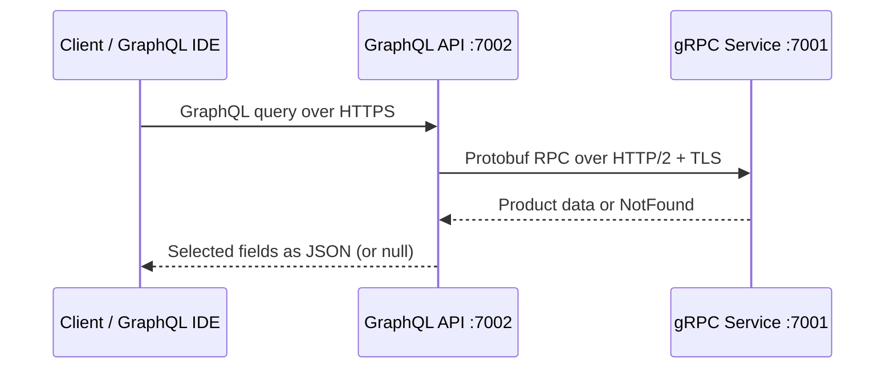

# ProductPoc — GraphQL gateway and gRPC service

A small ASP.NET Core **.NET 10** proof of concept. Both services use `net10.0`.



## Prerequisites

- .NET **10 SDK**, stable version. .NET 8 SDK cannot build `net10.0`; the .NET 8 prerequisite in the request was corrected to match the requested target.
- Access to NuGet for restore, and a browser for the embedded GraphQL IDE.
- Optional: VS Code REST Client, Rider, Postman, curl, Python 3, or grpcurl.

## Run the included solution

From the extracted `ProductPoc` folder:

```sh
dotnet --version
dotnet dev-certs https --trust
dotnet restore
dotnet build
```

Start the gRPC service first in terminal 1:

```sh
dotnet run --project ProductGrpcService --launch-profile https
```

Then start the gateway in terminal 2:

```sh
dotnet run --project ProductGraphQLApi --launch-profile https
```

Open **https://localhost:7002/graphql**. Hot Chocolate's embedded IDE is now named **Nitro** (formerly Banana Cake Pop). It is enabled in Development by the launch profile. Paste each query below and press Run.

Kestrel endpoints are configured in appsettings.json: gRPC HTTPS 7001 (HTTP/2), local HTTP 5001 (HTTP/2), and GraphQL HTTPS 7002. The gateway reads `GrpcService:Url`, defaulting to `https://localhost:7001`.

## HTTPS certificates

Run `dotnet dev-certs https --trust` as the same OS user running the services, then restart the services/browser. Verify with `dotnet dev-certs https --check --trust`. On Linux, follow the .NET certificate trust instructions for your distribution/browser if automatic trust is incomplete. Do not disable server certificate validation in application code.

For a **local-only** gRPC troubleshooting alternative, use the HTTP/2 port already configured on the service. In Bash, run the gateway with:

```sh
GrpcService__Url=http://localhost:5001 dotnet run --project ProductGraphQLApi --launch-profile https
```

In PowerShell:

```powershell
$env:GrpcService__Url = "http://localhost:5001"
dotnet run --project ProductGraphQLApi --launch-profile https
```

The GraphQL endpoint still uses HTTPS. Remove the environment override afterwards to return to TLS between services.

## Example queries and expected responses

These responses describe the fixed sample dataset. JSON formatting and numeric trailing zeros may vary.

### 1. All products, all fields

```graphql
{ products { id name description price category stockQuantity } }
```

```json
{
  "data": {
    "products": [
      {
        "id": 1,
        "name": "Wireless Mouse",
        "description": "Ergonomic Bluetooth mouse",
        "price": 24.99,
        "category": "Electronics",
        "stockQuantity": 45
      },
      {
        "id": 2,
        "name": "Mechanical Keyboard",
        "description": "Compact keyboard with tactile switches",
        "price": 79.99,
        "category": "Electronics",
        "stockQuantity": 20
      },
      {
        "id": 3,
        "name": "USB-C Hub",
        "description": "Seven-port USB-C adapter",
        "price": 39.99,
        "category": "Electronics",
        "stockQuantity": 30
      },
      {
        "id": 4,
        "name": "Clean Code",
        "description": "A guide to writing readable software",
        "price": 34.99,
        "category": "Books",
        "stockQuantity": 18
      },
      {
        "id": 5,
        "name": "The Pragmatic Programmer",
        "description": "Practical software development advice",
        "price": 42.5,
        "category": "Books",
        "stockQuantity": 12
      },
      {
        "id": 6,
        "name": "Learning C#",
        "description": "Beginner programming workbook",
        "price": 29.99,
        "category": "Books",
        "stockQuantity": 25
      },
      {
        "id": 7,
        "name": "Desk Lamp",
        "description": "Adjustable LED desk lamp",
        "price": 22.99,
        "category": "Home",
        "stockQuantity": 35
      },
      {
        "id": 8,
        "name": "Stainless Steel Bottle",
        "description": "Reusable 750 ml water bottle",
        "price": 16.99,
        "category": "Home",
        "stockQuantity": 60
      }
    ]
  }
}
```

### 2. Field selection

```graphql
{ products { id name price } }
```

```json
{
  "data": {
    "products": [
      {
        "id": 1,
        "name": "Wireless Mouse",
        "price": 24.99
      },
      {
        "id": 2,
        "name": "Mechanical Keyboard",
        "price": 79.99
      },
      {
        "id": 3,
        "name": "USB-C Hub",
        "price": 39.99
      },
      {
        "id": 4,
        "name": "Clean Code",
        "price": 34.99
      },
      {
        "id": 5,
        "name": "The Pragmatic Programmer",
        "price": 42.5
      },
      {
        "id": 6,
        "name": "Learning C#",
        "price": 29.99
      },
      {
        "id": 7,
        "name": "Desk Lamp",
        "price": 22.99
      },
      {
        "id": 8,
        "name": "Stainless Steel Bottle",
        "price": 16.99
      }
    ]
  }
}
```

### 3. Existing product

```graphql
{ productById(id: 1) { id name description price category stockQuantity } }
```

```json
{
  "data": {
    "productById": {
      "id": 1,
      "name": "Wireless Mouse",
      "description": "Ergonomic Bluetooth mouse",
      "price": 24.99,
      "category": "Electronics",
      "stockQuantity": 45
    }
  }
}
```

### 4. Missing product

```graphql
{ productById(id: 999) { id name description price category stockQuantity } }
```

```json
{
  "data": {
    "productById": null
  }
}
```

### 5. Optional category filter

```graphql
{ products(category: "Books") { id name category } }
```

```json
{
  "data": {
    "products": [
      {
        "id": 4,
        "name": "Clean Code",
        "category": "Books"
      },
      {
        "id": 5,
        "name": "The Pragmatic Programmer",
        "category": "Books"
      },
      {
        "id": 6,
        "name": "Learning C#",
        "category": "Books"
      }
    ]
  }
}
```

The gateway maps gRPC `NotFound` to a nullable `productById` result. It translates other RPC failures into clean GraphQL errors without stack traces. Calls have a five-second deadline and forward the request cancellation token. The in-memory service uses `Task.FromResult` because it performs no asynchronous I/O; gateway network calls use async/await.

The optional category filter is case-insensitive and runs in the gateway after fetching all products. GraphQL field selection limits the JSON response; it does not reduce the fields transferred by this gRPC contract.

## Testing

1. Build and start both services using the commands above.
2. Open the embedded IDE at https://localhost:7002/graphql.
3. Run examples 1–4 and compare against the expected responses. Confirm eight products, only three selected fields in example 2, ID 1 in example 3, and `null` without a stack trace in example 4.
4. Run the category example; expect the three Books products.
5. Stop the gRPC service and run a query again. Expect a clean `PRODUCT_SERVICE_UNAVAILABLE` error. Restart the service afterward.

`requests.http` contains the same five requests for VS Code REST Client or Rider. In Postman, POST to `https://localhost:7002/graphql`, choose raw JSON, and copy a request body from that file.

A curl example (use the trusted development certificate):

```sh
curl https://localhost:7002/graphql -H 'Content-Type: application/json' --data '{"query":"{ products { id name price } }"}'
```

Optional executable HTTP smoke test, with both services running:

```sh
python3 tests/smoke_test.py
```

If Python/curl uses a different trust store, export the public development certificate and pass it explicitly:

```sh
dotnet dev-certs https --export-path /tmp/productpoc-cert.pem --format PEM
python3 tests/smoke_test.py --ca-file /tmp/productpoc-cert.pem
curl --cacert /tmp/productpoc-cert.pem https://localhost:7002/graphql -H 'Content-Type: application/json' --data '{"query":"{ productById(id: 999) { id } }"}'
```

Reflection is enabled only in Development. Inspect the local HTTP/2 port with grpcurl:

```sh
grpcurl -plaintext localhost:5001 list
grpcurl -plaintext localhost:5001 describe product.ProductService
grpcurl -plaintext -d '{}' localhost:5001 product.ProductService/GetProducts
grpcurl -plaintext -d '{"id":999}' localhost:5001 product.ProductService/GetProductById
```

The last RPC returns the `NotFound` status with a clear message.

## Scaffold from scratch

These commands create the starting projects in a **new directory**. Then copy the supplied implementation/configuration files into them, overwriting generated Program.cs, csproj, appsettings.json and launchSettings.json files. Delete the template `greet.proto` and `GreeterService.cs`; the delivered solution already omits them.

```sh
mkdir ProductPoc
cd ProductPoc
dotnet new globaljson --sdk-version 10.0.100 --roll-forward latestFeature
dotnet new sln --name ProductPoc
dotnet new grpc --name ProductGrpcService --framework net10.0 --no-restore
dotnet new web --name ProductGraphQLApi --framework net10.0 --no-restore
dotnet sln add ProductGrpcService/ProductGrpcService.csproj ProductGraphQLApi/ProductGraphQLApi.csproj
dotnet add ProductGrpcService package Grpc.AspNetCore --version 2.76.0
dotnet add ProductGrpcService package Grpc.AspNetCore.Server.Reflection --version 2.76.0
dotnet add ProductGraphQLApi package HotChocolate.AspNetCore --version 15.1.20
dotnet add ProductGraphQLApi package Grpc.Net.ClientFactory --version 2.76.0
dotnet add ProductGraphQLApi package Google.Protobuf --version 3.31.1
dotnet add ProductGraphQLApi package Grpc.Tools --version 2.76.0
```

The gateway is an ASP.NET Core HTTP API using the minimal `web` template; controllers and OpenAPI are unnecessary for this GraphQL-only API. The solution uses .NET 10's `.slnx` format, supported by `dotnet build`.

No `dotnet add reference` is needed. Each project compiles the same proto with its own server/client generation. Referencing the server project as well would duplicate generated message types. The gateway csproj contains:

```xml
<Protobuf Include="../ProductGrpcService/Protos/product.proto"
          Link="Protos/product.proto" GrpcServices="Client" />
```

Keep `Grpc.Tools` marked `PrivateAssets="All"` as in the supplied csproj. All package versions are pinned stable releases.

## Source layout

```text
ProductPoc.slnx
global.json
README.md
requests.http
ProductGrpcService/
  ProductGrpcService.csproj
  Program.cs
  appsettings.json
  Properties/launchSettings.json
  Protos/product.proto
  Services/ProductServiceImpl.cs
ProductGraphQLApi/
  ProductGraphQLApi.csproj
  Program.cs
  appsettings.json
  Properties/launchSettings.json
  GraphQL/ProductType.cs
  GraphQL/Query.cs
tests/smoke_test.py
VALIDATION.md
```

Generated protobuf C# files appear under `obj/` during build. They should not be hand-edited or committed.

## Scope limitations

- Eight fixed products across Electronics, Books, and Home; no persistence or database.
- No authentication, authorization, Docker, or full microservices infrastructure.
- Read-only queries; no CRUD mutations, pagination, caching, or retries.
- `double` price follows the requested contract; real financial systems need a suitable decimal/money representation.
- Local development certificates and loopback endpoints; not a production deployment.

## Official references

- https://learn.microsoft.com/aspnet/core/grpc/aspnetcore?view=aspnetcore-10.0
- https://learn.microsoft.com/aspnet/core/grpc/clientfactory?view=aspnetcore-10.0
- https://learn.microsoft.com/aspnet/core/grpc/test-tools?view=aspnetcore-10.0
- https://learn.microsoft.com/aspnet/core/security/enforcing-ssl?view=aspnetcore-10.0
- https://chillicream.com/docs/hotchocolate/v15/
- https://protobuf.dev/programming-guides/proto3/
